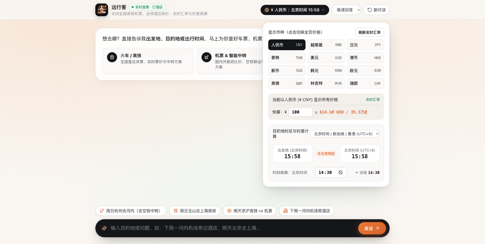
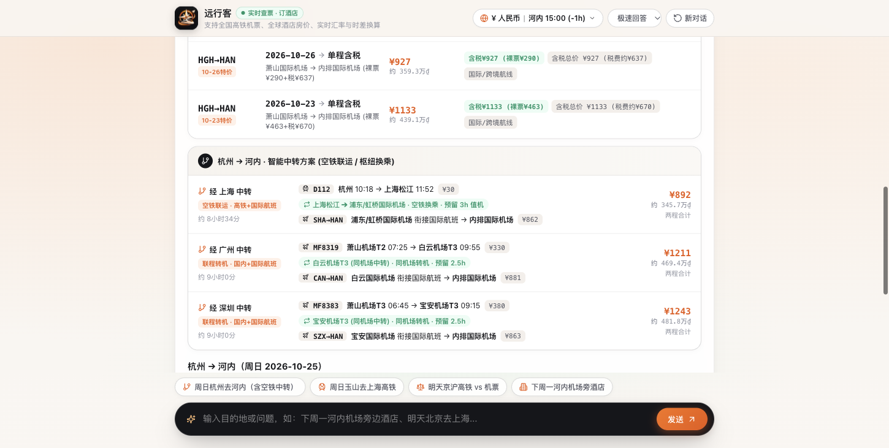
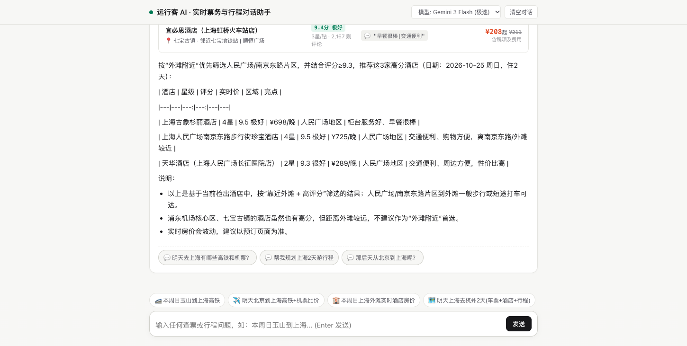
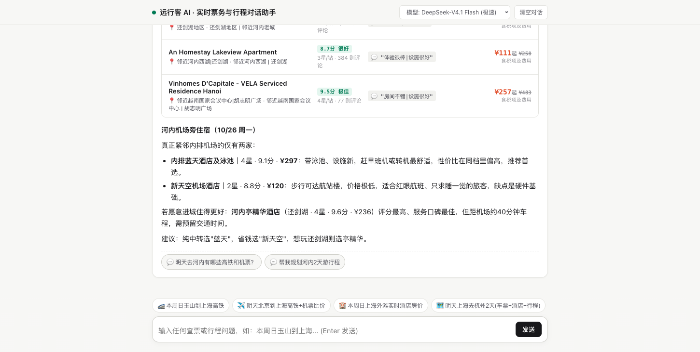

<div align="center">


# Personal Travel Agent

**Conversational AI travel assistant for live train tickets, flights, smart multi-modal transfers, global hotels, currency exchange, and itinerary planning.**

[](LICENSE)
[](https://www.python.org/)
[](#quick-start)

[**English**](README.md) | [**简体中文**](README_zh.md)

</div>

---

> **Branch notice** — `main` is the personal-use tool (scrapes 12306 / Ctrip / Tongcheng, Chinese UI, not for public deployment). `commercial` is the compliant, paid product line (whitelisted official & affiliate APIs only, English-first, USD billing). See [BRANCHES.md](BRANCHES.md) before you open a PR.

---

## ✨ Key Capabilities

- **🚄 Live Train & High-Speed Rail** — Real-time seat availability, fares across all cabin classes, and station-by-station stopover timetables across 3,300+ Chinese stations (including county-level towns).
- **✈️ Domestic & International Flights** — Live flight schedules, tax-inclusive fares, cabin discounts, and automatic door-to-door time & cost comparison against high-speed rail.
- **🔀 Smart Multi-Modal Transfers** — Automatically computes **Air-Rail (`Rail + Flight`)**, **Connecting Flights (`Flight + Flight`)**, and **Same-Station / Same-City Rail Transfers (`Rail + Rail`)** when direct routes are unavailable or cross-border.
- **🏨 Global & Domestic Hotels** — Real-time hotel rates across global cities and domestic counties with precise filtering by airport, train station, business district, or landmark.
- **💱 Live Currency & Timezone Calculator** — Automatically detects destination currency and local time, supports 1-click multi-currency price display, custom manual exchange rates, and dual-clock timezone conversion.
- **🗓️ Custom Itineraries & Calendar Export** — Generates day-by-day travel plans grounded in real ticket and hotel prices, with one-click `.ics` calendar export.

## 📸 Product Preview

| Conversational Home & FX / Timezone Bar | Smart Transfer (Air-Rail & Connecting Flights) |
| :---: | :---: |
|  |  |

| High-Speed Rail vs. Flight + Hotel + Itinerary | Global Airport & Landmark Hotel Search |
| :---: | :---: |
|  |  |

## 🚀 Quick Start

Requires **Python 3.9+** and `curl`.

```bash
# 1. Clone the repository & install dependencies
git clone https://github.com/nans94759-sketch/personal-travel-agent.git
cd personal-travel-agent
pip install -r requirements.txt

# 2. Configure your API key
cp .env.example .env
# Edit .env and set LLM_API_KEY=your_key

# 3. Start the server
python3 server.py
```

Open **[http://127.0.0.1:8868](http://127.0.0.1:8868)** and ask:
- `"周天杭州去河内有什么航班？"` *(International route + automatic Air-Rail & Hub Flight transfers)*
- `"明天福州去玉山的高铁有哪些？"` *(County-level high-speed rail tickets & fares)*
- `"下周一北京去上海，对比高铁和飞机，顺便看外滩附近酒店"` *(Rail vs. flight comparison + landmark hotel search)*
- `"河内，机场旁边，酒店价格，下周一"` *(Overseas airport hotel search + automatic VND currency & timezone conversion)*

## 📄 License

Released under the [MIT License](LICENSE).
