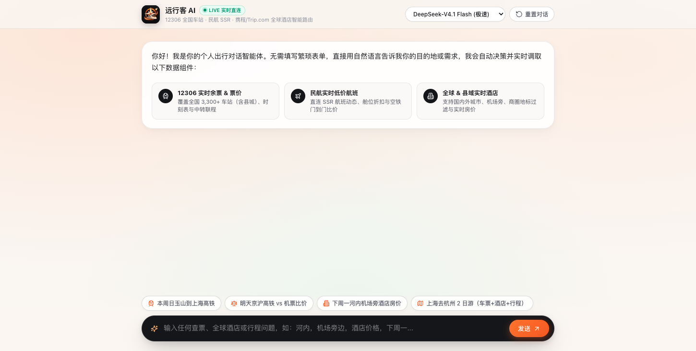
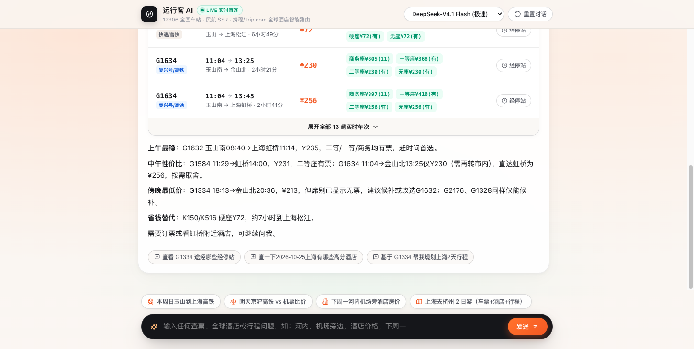

<div align="center">


# Personal Travel Agent

**Minimalist conversational AI agent for live rail tickets, flights, global hotels, and itinerary planning.**  
*Zero mock data · Dribbble-grade Warm Canyon UI · GSAP 3 + Lucide Icons*

[](LICENSE)
[](https://www.python.org/)
[](#quick-start)
[](#quick-start)

[**English**](README.md) | [**简体中文**](README_zh.md)

</div>

---

## ✨ Features

- **🤖 Autonomous Tool Routing** — The LLM reads a structured tool specification (`ai_route_tools`) and decides which live endpoints to invoke from natural language.
- **🚄 12306 Live Rail (`provider_12306.py`)** — Covers 3,300+ Chinese stations (including county towns), decodes seat prices directly from `infoAll_list` in a single request, and computes 1-stop hub transfers.
- **✈️ Live Flights (`provider_flights.py`)** — Extracts real-time lowest fares, aircraft types, and on-time rates via SSR state parsing, plus door-to-door rail vs. flight comparison.
- **🏨 Global & County Hotels (`provider_hotels.py`)** — Supports domestic cities/counties and international cities (e.g., Hanoi, Tokyo, Bangkok) with landmark/airport filtering (`zone` & `filterId`) and live CNY rates.
- **💬 Pure Chat UI (`static/index.html`)** — Single-column chat interface that renders interactive ticket, flight, hotel, timetable, and itinerary widgets inline.

## 📸 Preview

| Dribbble-Inspired Conversational Home | Live 12306 Rail + DeepSeek Summary |
| :---: | :---: |
|  |  |

| Door-to-Door Flight/Rail + Hotel + Itinerary | Landmark & Airport Hotel Search (e.g., Hanoi Airport) |
| :---: | :---: |
|  |  |

## 🛠️ Built-in Agent Tools

| Tool | Source | Description |
| :--- | :--- | :--- |
| `query_trains` | 12306 Official | Live train availability & embedded multi-seat price decoding |
| `query_stopovers` | 12306 Official | Station-by-station stopover timetable (`G1632`, etc.) |
| `query_transfers` | 12306 Official | Automated 1-stop national hub transfer calculation |
| `query_flights` | Tongcheng SSR | Live domestic flight schedules, lowest fares & cabin discounts |
| `query_hotels` | Ctrip H5 + Trip.com SSR | Global/domestic hotel live prices with airport, zone & landmark filters |

## 🚀 Quick Start

No third-party Python packages or headless browsers required. Works out of the box with **Python 3.9+** and `curl`.

```bash
# 1. Clone the repository
git clone https://github.com/nans94759-sketch/personal-travel-agent.git
cd personal-travel-agent

# 2. Configure your OpenAI-compatible / DeepSeek API key
cp .env.example .env
# Edit .env and set LLM_API_KEY=your_key

# 3. Start the server
python3 server.py
```

Open **[http://127.0.0.1:8868](http://127.0.0.1:8868)** and try:
- `"明天福州去玉山的高铁有哪些？"` *(County-level high-speed rail)*
- `"下周一北京去上海，对比高铁和飞机，顺便看外滩附近酒店"` *(Rail vs. flight + hotel zone)*
- `"河内，机场旁边，酒店价格，下周一"` *(International city + airport landmark filter)*

## 🤝 Contributing

PRs and issues are welcome! High-impact areas to explore:
- [ ] **International Flight Routes** — Extend `provider_flights.py` to support cross-border IATA routes.
- [ ] **SSE Token Streaming** — Stream LLM markdown summaries after rendering live data widgets.
- [ ] **More Local Tools** — Add weather, transit duration, or attraction ticket availability to `ai_route_tools`.

## 📄 License

Released under the [MIT License](LICENSE).
